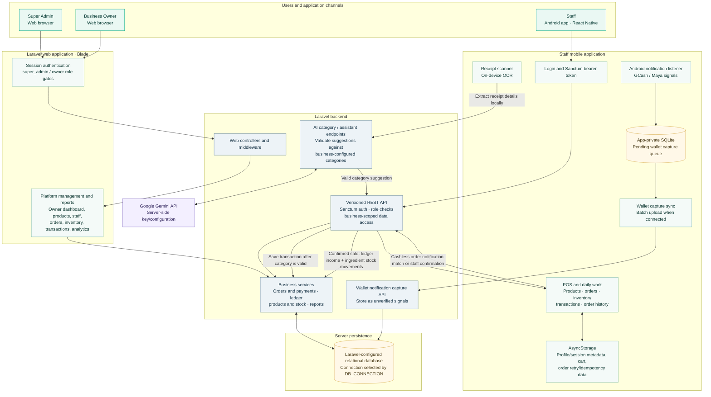

# GastoTrack System Diagrams

This document follows the reference's two-part structure—high-level system architecture followed by a database entity diagram—while describing GastoTrack's current implementation. The PetCare-specific content in the reference is not carried over.

## High-Level System Architecture

### Operational notes

- The mobile app is staff-focused. Owners and Super Admins use the Laravel web interface; an owner account is blocked from the staff POS app.
- AsyncStorage is not a local business database. It persists staff session/profile metadata, the current cart, and order retry protection. Product, inventory, order-history, and transaction records are requested from the API.
- Android SQLite is used specifically for a durable queue of captured GCash/Maya notification signals. The queue syncs to Laravel when the device is connected. A notification is not provider verification; staff must check the wallet account, and the matching workflow is recorded as non-authoritative.
- Receipt OCR runs on-device. Laravel sends the category request to Gemini and checks that its answer matches a category configured for that business. A valid result is saved as a transaction; if AI cannot produce a valid category, the app offers a manual edit/save path.
- Confirmed, completed orders create a sales transaction and ingredient stock movements. Cash is recorded from the staff member's cash-received attestation; cashless orders require the payment workflow before financial effects are committed.
- No offline-first product, inventory, or transaction sync queue was found. A saved cart can be restored locally, but submitting or refreshing business records requires the API.

## Database Entity Diagram

The ERD focuses on application/domain tables and their foreign keys. Laravel framework tables for cache, queues, sessions, and migrations are intentionally omitted.

```mermaid
erDiagram
    BUSINESSES {
        bigint id PK
        bigint owner_id FK "nullable assigned owner"
        string name
        string business_type
        string status
        boolean active
        char currency
        int next_order_number
        timestamp deleted_at
    }

    USERS {
        bigint id PK
        bigint business_id FK "nullable business membership"
        string name
        string email UK
        string role "owner, staff, super_admin"
        string status
        timestamp deleted_at
    }

    PRODUCTS {
        bigint id PK
        bigint business_id FK
        string name
        string category
        decimal price
        boolean active
        boolean is_available
        timestamp deleted_at
    }

    STOCK_ITEMS {
        bigint id PK
        bigint business_id FK
        string name
        string unit
        decimal current_quantity
        decimal minimum_quantity
        decimal unit_cost
        boolean active
        timestamp deleted_at
    }

    PRODUCT_INGREDIENTS {
        bigint id PK
        bigint product_id FK
        bigint stock_item_id FK
        decimal quantity
        string unique_product_stock_pair UK
    }

    ORDERS {
        bigint id PK
        bigint business_id FK
        bigint user_id FK "staff creator"
        bigint cancelled_by FK "nullable user"
        bigint payment_confirmed_by FK "nullable user"
        string order_number
        string status
        string payment_status
        string payment_method
        decimal total
        uuid client_id UK
        timestamp financials_committed_at
        timestamp deleted_at
    }

    ORDER_ITEMS {
        bigint id PK
        bigint order_id FK
        bigint product_id FK
        string product_name "order-time snapshot"
        int quantity
        decimal price
        decimal subtotal
        json ingredients_snapshot
    }

    TRANSACTIONS {
        bigint id PK
        bigint business_id FK
        bigint user_id FK
        bigint order_id FK "nullable unique"
        bigint reversal_of_id FK "nullable unique self-reference"
        string type
        string category
        decimal amount
        date transaction_date
        string entry_method
        uuid client_id UK
        timestamp deleted_at
    }

    STOCK_MOVEMENTS {
        bigint id PK
        bigint stock_item_id FK
        bigint user_id FK
        bigint order_id FK "nullable"
        bigint reversal_of_id FK "nullable unique self-reference"
        string type
        decimal quantity
        decimal previous_quantity
        decimal new_quantity
        uuid client_id UK
    }

    ORDER_PAYMENT_EVENTS {
        bigint id PK
        bigint order_id FK
        bigint business_id FK
        bigint user_id FK "nullable actor"
        string event_type
        string from_payment_status
        string to_payment_status
        decimal amount
        string reference
        json details
    }

    WALLET_NOTIFICATION_CAPTURES {
        bigint id PK
        uuid client_id UK
        bigint business_id FK
        bigint user_id FK "nullable capturer"
        string source
        string direction
        decimal amount
        string merchant
        timestamp captured_at
    }

    TRANSACTION_OPTIONS {
        bigint id PK
        bigint business_id FK
        string kind
        string transaction_type
        string name
        string unique_business_kind_type_name UK
    }

    GOALS {
        bigint id PK
        bigint business_id FK
        string name
        decimal target_amount
        decimal current_amount
        string goal_type
        date period_start
        string status
    }

    NOTIFICATIONS {
        bigint id PK
        bigint user_id FK
        bigint business_id FK
        string type
        string title
        json data
        timestamp read_at
    }

    ACTIVITY_LOGS {
        bigint id PK
        bigint business_id FK "nullable"
        bigint user_id FK "nullable actor"
        string action
        string subject_type "polymorphic"
        bigint subject_id "polymorphic"
        json old_values
        json new_values
        string ip_address
    }

    VIOLATION_REPORTS {
        bigint id PK
        bigint business_id FK
        bigint reported_by FK "nullable user"
        string subject
        string category
        string priority
        string status
        timestamp resolved_at
    }

    USERS o|--o{ BUSINESSES : owns
    BUSINESSES o|--o{ USERS : has_members
    BUSINESSES ||--o{ PRODUCTS : offers
    BUSINESSES ||--o{ STOCK_ITEMS : tracks
    PRODUCTS ||--o{ PRODUCT_INGREDIENTS : recipe_lines
    STOCK_ITEMS ||--o{ PRODUCT_INGREDIENTS : ingredient_for
    BUSINESSES ||--o{ ORDERS : receives
    USERS ||--o{ ORDERS : creates
    USERS o|--o{ ORDERS : confirms_or_cancels
    ORDERS ||--o{ ORDER_ITEMS : contains
    PRODUCTS ||--o{ ORDER_ITEMS : sold_as
    BUSINESSES ||--o{ TRANSACTIONS : records
    USERS ||--o{ TRANSACTIONS : records
    ORDERS o|--o| TRANSACTIONS : sale_entry
    TRANSACTIONS o|--o| TRANSACTIONS : reversed_by_or_reverses
    STOCK_ITEMS ||--o{ STOCK_MOVEMENTS : movement_history
    USERS ||--o{ STOCK_MOVEMENTS : performs
    ORDERS o|--o{ STOCK_MOVEMENTS : may_trigger
    STOCK_MOVEMENTS o|--o| STOCK_MOVEMENTS : reversal_link
    ORDERS ||--o{ ORDER_PAYMENT_EVENTS : payment_audit
    BUSINESSES ||--o{ ORDER_PAYMENT_EVENTS : scopes
    USERS o|--o{ ORDER_PAYMENT_EVENTS : acts
    BUSINESSES ||--o{ WALLET_NOTIFICATION_CAPTURES : scopes
    USERS o|--o{ WALLET_NOTIFICATION_CAPTURES : captures
    BUSINESSES ||--o{ TRANSACTION_OPTIONS : configures
    BUSINESSES ||--o{ GOALS : sets
    USERS ||--o{ NOTIFICATIONS : receives
    BUSINESSES ||--o{ NOTIFICATIONS : scopes
    USERS o|--o{ ACTIVITY_LOGS : performs
    BUSINESSES o|--o{ ACTIVITY_LOGS : scopes
    BUSINESSES ||--o{ BUGS_REPORTS : receives
    USERS o|--o{ BUGS_REPORTS : reports
```

### ERD scope and schema notes

- Tenant ownership is represented by `business_id` on business records. The code scopes owner/staff API access to the signed-in user's business; Super Admin web routes are separately role-gated.
- `products.category` is stored as text, while transaction categories/sources are business-configured rows in `transaction_options`; there is no normalized product-category table in the migrations.
- `activity_logs.subject_type` / `subject_id` is a polymorphic reference, so its target cannot be represented as a conventional foreign key. The current schema has `activity_logs`; no `admin_activity_logs` table was found.
- The current migrations/models do not define a branches table or subscription plan/status/expiry columns. Those concepts are therefore not drawn as implemented schema.
- The diagram is derived from the repository's migrations and model relationships, not from a live database dump. Optional and polymorphic links are marked as such.
